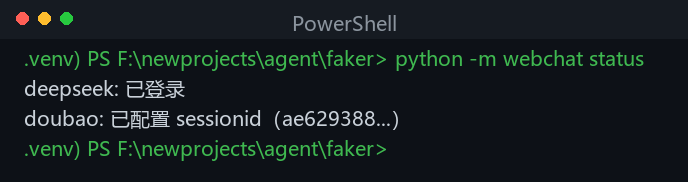
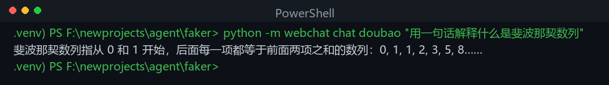
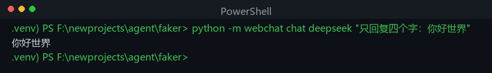
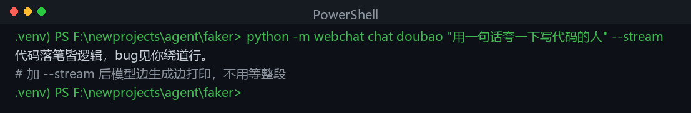
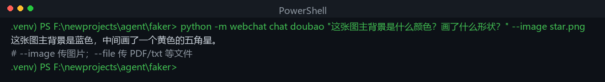

# webchat —— 用 Python 免费和 DeepSeek / 豆包网页版对话

> 不想花钱调用官方 API、又想用 Python 自动化和大模型聊天？
> 本项目把 **DeepSeek 官网**、**豆包官网** 的网页版聊天，封装成一个可直接调用的 Python 函数。
> **登录一次，之后用代码发文本/图片/文件，就能拿到模型回复**，适合想摸索网页接口、又不想付费调 API 的同学学习使用。
>
> ⚠️ 本项目仅供学习与个人研究使用，请勿用于商业用途或高频自动化。

---

## ✨ 它能做什么

- 🆓 **免费调用**：复用你自己在网页版的登录态，不需要申请 API Key、不消耗 API 额度
- 📞 **一个函数调多家**：`webchat.chat("doubao" / "deepseek", ...)`
- 💬 **多轮对话**：记住上下文，接着上一句聊
- 🧠 **深度思考**：拿到模型的思考过程（R1 推理 / 豆包 think）
- 🖼️ **多模态**：发图片、传文件（PDF/txt 等）让模型理解
- 🌊 **流式输出**：边生成边打印

## 支持的服务

| Provider | 登录方式 | 多模态 | 特性 |
|---|---|---|---|
| `deepseek` | 浏览器自动登录取 token，或手动粘贴 | 图片 / 文件 | `deepseek-chat` / `deepseek-reasoner`、联网搜索、多轮续聊 |
| `doubao` | 手机豆包 App 扫码 | 图片 / 文件 | 深度思考（think 0/1/2/3）、搜索、多轮续聊 |

## 🚀 快速开始

### 环境要求

- **Python 3.10+**
- **Node.js ≥ 18**（仅 DeepSeek 的 PoW 求解需要；只用豆包可不装）
- **Google Chrome**（仅 `login deepseek` 自动登录需要；没有可用 `playwright install chromium`）

### 安装

```bash
git clone https://github.com/orangefplus/nvldla.git
cd nvldla/faker

python -m venv .venv
# Windows
.venv\Scripts\activate
# macOS / Linux
# source .venv/bin/activate

pip install -r requirements.txt
```

### 登录（只做一次）

```bash
# 豆包：会自动弹出二维码图片，用手机豆包 App「扫一扫」
python -m webchat login doubao

# DeepSeek：自动打开 Chrome 窗口，在网页里登录后自动保存 token
python -m webchat login deepseek

# 查看登录状态
python -m webchat status
```

### 开始聊天

```bash
# 命令行
python -m webchat chat doubao "用一句话介绍成都" --think 1
python -m webchat chat deepseek "9.11 和 9.9 哪个大" --model deepseek-reasoner
```

```python
# 在自己的代码里
import webchat

r = webchat.chat("doubao", "你好，介绍一下你自己")
print(r.text)

# DeepSeek 推理模型：思考过程 + 回答分开
r2 = webchat.chat("deepseek", "写一首诗", model="deepseek-reasoner")
print(r2.reasoning)   # 思考过程
print(r2.text)        # 回答

# 多模态
webchat.chat("doubao", "这张图里有什么？", images=["a.jpg"])
webchat.chat("deepseek", "总结这个 PDF", files=["doc.pdf"])

# 多轮续聊
webchat.chat("doubao", "再详细一点", conversation_id=r2.conversation_id)

# 流式输出
webchat.chat("doubao", "讲个笑话", think=1, stream=True,
             on_chunk=lambda t: print(t, end="", flush=True))
```

更多示例见 `examples/`。

## 📸 效果展示

登录状态：



和豆包对话：



和 DeepSeek 对话：



流式输出（边生成边打印）：



多模态（传图片让模型理解）：



## 🔧 实现原理

本质是**直接重放网页前端在后台发出的 HTTP 请求**：网页只是个壳，真正干活的是它背后的接口。本项目用你登录后的凭证（token / cookie）直接调这些接口，再把 SSE 流式响应解析成文本。

- **DeepSeek**：`userToken` 做 Bearer 鉴权；每次请求前用官网同款 WASM 解一道 PoW 数学题（Node 执行 `pow_solver.mjs`），再请求 `/api/v0/chat/completion`。
- **豆包**：扫码拿到的 `sessionid` 等 Cookie 直接请求 `/chat/completion`；图片/文件走网页同款上传链路。

协议参考实现见 `NOTICE.md`。

## 📁 目录结构

```
nvldla/
├── faker/                 # 本包所在目录（webchat）
│   ├── webchat/           # 主包
│   │   ├── __init__.py    # 统一入口：chat() / login()
│   │   ├── __main__.py    # CLI：login / token / chat / status
│   │   ├── deepseek.py    # DeepSeek 网页客户端（纯 HTTP + PoW）
│   │   ├── doubao.py      # 豆包网页客户端（纯 HTTP + 上传）
│   │   ├── doubao_login.py# 豆包扫码登录
│   │   ├── pow_solver.mjs # Node WASM PoW 求解器
│   │   ├── sha3_wasm_bg.wasm  # DeepSeek 官方 PoW WASM
│   │   ├── config.py      # 配置读写
│   │   └── sse.py         # SSE 流解析
│   ├── examples/          # 示例脚本
│   ├── requirements.txt
│   └── config.example.json
└── screenshotask/         # 截图问答助手 GUI（另见仓库根 README）
```

## ⚠️ 说明与风险

- 这是对网页版内部接口的**非官方封装**，**仅供学习与个人研究使用**，请勿商用或高频自动化调用。
- 上游可能随时修改接口或收紧风控；频繁自动化可能触发临时风控 / 验证码，请自行承担账号风险。
- 登录态保存在 `config.json` 与 `webchat/sessions/` 下（已在 `.gitignore` 中排除），**不要把自己的凭证提交到公开仓库**。
- 遇到失效（401 / 鉴权错误）时，重新跑一次 `login` 即可。

## 📄 开源说明

协议移植自开源项目（Apache-2.0），详见 `NOTICE.md`。
